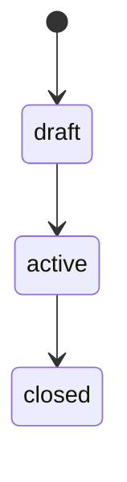

# <Concept> — domain

Checked against: <repo>@<sha>, <repo>@<sha>
Sources: <sources/<topic>/<file>, or none>

## What it is

<2–4 plain sentences: what this concept is for, in glossary terms. Link the glossary row.>

## Lifecycle

| Transition | Who triggers it | Allowed when | Side effects |
|---|---|---|---|
| draft → active | **<actor>** | <precondition> | <email, webhook, ledger entry> |

## Rules and invariants

Each rule: the rule, then where it is enforced. A rule enforced in only one repo says so.

- <rule, e.g. "an order's total never changes after payment"> — BE `<path>` `<symbol>`; FE <also / not checked>

## Where it lives

| Repo | Model / table / type | Main entry points |
|---|---|---|
| <repo> | `<name>` | `<path>` |

## Open questions

- <unclear rule, with who could answer it>
