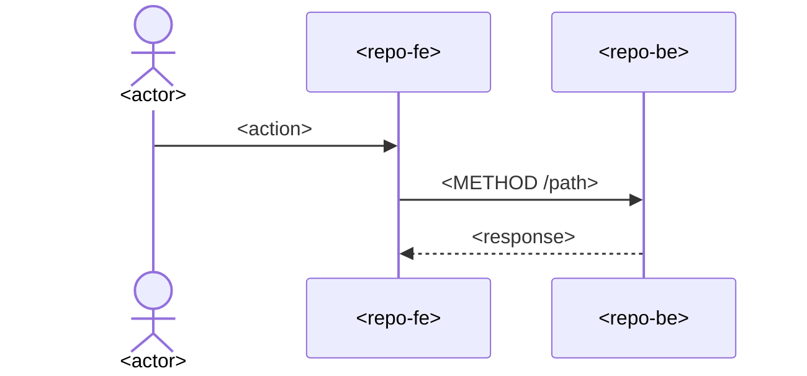

# <Feature> — how it works

Checked against: <repo>@<sha>, <repo>@<sha>

## In plain words

<3–5 sentences, glossary terms: who does what, what the system does in response.>

## Flow

## Steps

| Step | Repo | Code | Notes |
|---|---|---|---|
| <trigger> | <repo> | `<path>` `<symbol>` | <validation, side effect> |

## Edge cases and failure modes

- <what happens when X fails / is empty / races>

## Related

- Domain: [`domain/<concept>.md`](../domain/) · Decisions: <rj-dNNN> · Plans: <archived plan IDs that shaped it>
