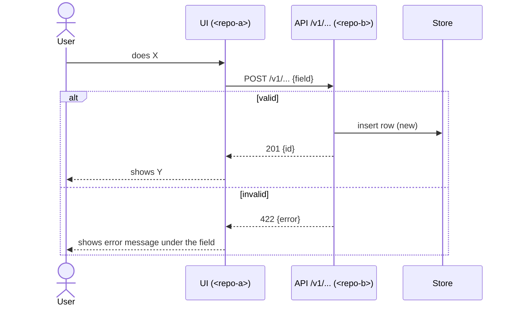
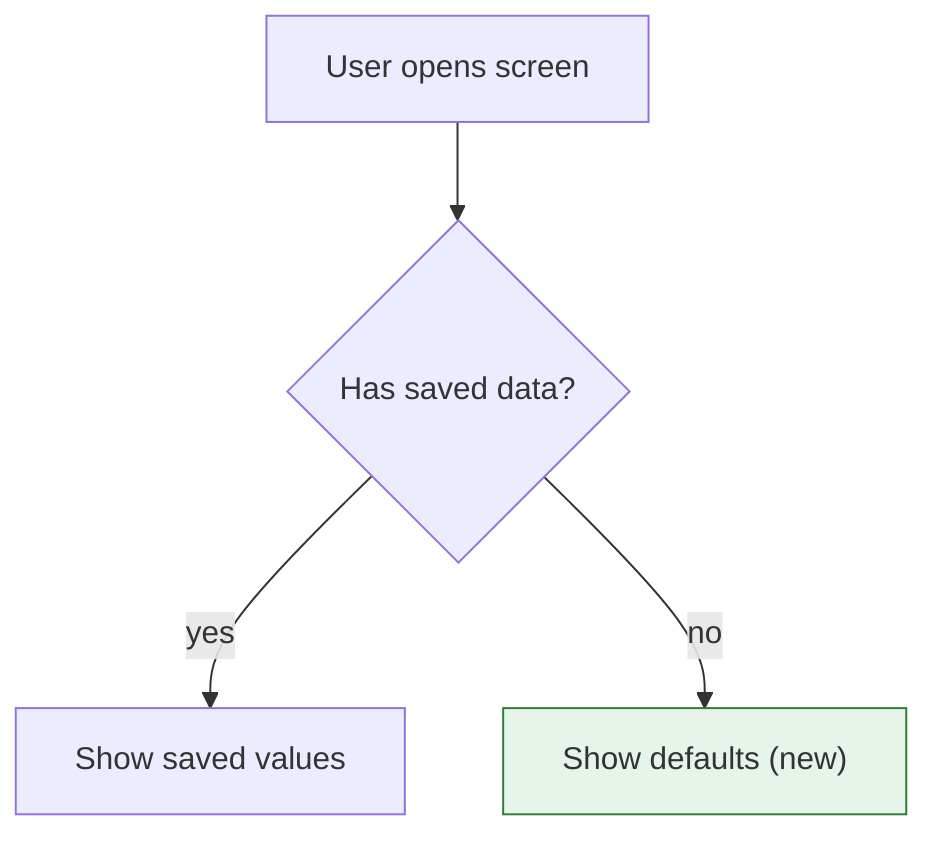
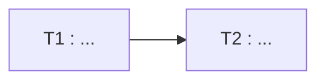

# NNN — <Title>

Status: proposed · YYYY-MM-DD · repos: `<repo>` (<size>)…
Based on: <repo> `<branch>@<sha>` … · depends on: <NNN or none> · blocks: <NNN or none>
Intent: <intents/<code>/NNN_slug.md, or omit the line>
Sources: <`sources/<topic>/<file>` …, or omit the line>
Context: <`context/…` notes this plan relies on, or omit the line>

## In plain words

<3–6 short sentences a non-engineer understands. What problem, for whom (which user role), what they will be able to do after this, and the one big idea of how. No code names.>

**Before:** <what the user experiences today>
**After:** <what the user experiences when this ships>

## How it works

<One sentence of setup, then the diagram(s). Pick the type that fits — see ws-plan §4b.>



<One sentence: what to notice in this diagram.>



<One sentence: what to notice.>

## Glossary

<Only terms new to this plan; existing ones are in `context/glossary.md` — use them as written.>

| Term | Means | In code |
|---|---|---|
| <new term used in this plan> | <one plain sentence> | `<code name / table / key>` |

## Goal

<2–4 sentences: the outcome, for whom, and why now. From an intent: one line linking it plus
this plan's slice of its scope; don't restate its Problem/Outcome/Non-goals.>

Success:
- <observable outcome>
- <observable outcome>

Non-goals:
- <tempting adjacent thing we are NOT doing>

## Current state

What the code does today on this path, with evidence. Only facts that shape the design.

| Where | What it does now | Why it matters |
|---|---|---|
| `repositories/<repo-b>/path/to/handler.ext` `CreateX()` | … | … |
| `repositories/<repo-a>/path/to/module.ext` `buildY()` ~L120 | … | … |

Pattern to follow: <nearest existing feature + path> — copy its shape.

## Decisions

**<Decision>** — <choice>, because <reason>. <Alternative rejected and why, one line.>
<Mark one `(lasting)` when it binds future work beyond this plan — ws-archive offers it as a
`context/decisions/` ADR. Follows an existing ADR → cite it: "per rj-d002".>

<Options table only when there were genuinely competing designs:>

| Option | For | Against |
|---|---|---|
| **A (chosen)** | … | … |
| B | … | … |

## Design

### Contracts

<Exact shapes that cross a boundary. Endpoint + method + request/response, schema keys,
DB columns, JSON objects. Snippets only where the shape is the decision.>

```
POST /v1/…
{ "field": "string", "optional?": 0 }
```

### Data / migration

<Tables, columns, indexes, backfill, compatibility with existing data. Or N/A.>

## Changes by repo

<Repeat this block for each repo touched.>

### <repo>
| File | Change |
|---|---|
| `path/…` | … |
| `path/…` **new** | … |

## Tasks

Ordered; each leaves the build green. `needs:` lists blockers. Each task stands alone: an
agent reading only this task + the named files must not have to guess anything.



- [ ] **T1 · <repo-b>** — <imperative summary, exact action>
  Files: `…`, `…` · Follow: `<pattern path>`
  Input → output: <what exists before> → <what exists after, e.g. "endpoint returns 201 with {id}">
  Edge cases: <empty / invalid / missing / permission — and the required behaviour for each>
  Verify: `cd repositories/<repo-b> && <scoped test command, see WORKFLOW.md § 5>`
- [ ] **T2 · <repo-a>** — <summary> · needs: T1
  Files: `…`
  Verify: `cd repositories/<repo-a> && <scoped test command>` + UI shows <thing> at <viewport>

## Testing

- Unit / integration: <what new tests, where>
- Manual / visual: <flows, viewport, variants to check>
- Regression: <existing behaviour that must still work>

## Rollout & risks

1. <order of merge/deploy, flags, republish steps>

| Risk | Mitigation |
|---|---|
| … | … |

## Acceptance

- [ ] <behaviour a reviewer can check without reading the code>
- [ ] Every repo that parses the payload validates the same rules.

## Open questions

- <question> — recommended: <answer>. (Blocks: T<n> / nothing)
