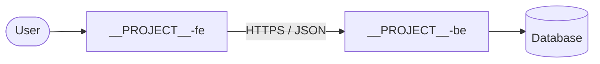

# System overview — __PROJECT__

Checked against: <repo>@<sha>, <repo>@<sha>

The map a newcomer reads first. Detail lives in the repos and in the feature notes beside this one.

## Components

| Component | Repo / where | Does | Talks to |
|---|---|---|---|
| <app or service> | `repositories/<repo>/` | <one line> | <components> |

## Data stores

| Store | Kind | Owner | Holds |
|---|---|---|---|
| <name> | <Postgres · Redis · S3 · …> | <repo> | <main data> |

## Environments

| Env | URL | Deployed from | How |
|---|---|---|---|
| <dev / staging / prod> | <url> | <branch> | <what triggers it — see `WORKFLOW.md` § 7> |
